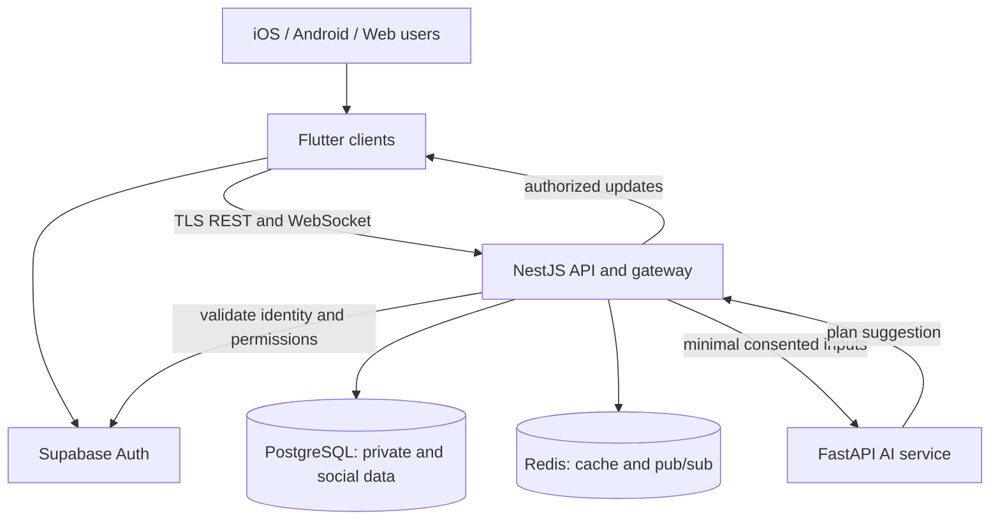

# IT3060 Human Computer Interaction - Lab Exercise 05
## FitFlow redesign technology selection and architecture

**Student:** [Your name / ID]  
**Repository:** `https://github.com/YOUR_USERNAME/fitflow-redesign` (replace after publishing)  
**Date:** 28 September 2026

### Scope and assumptions
The separate CourseWeb case study was not supplied. This report uses only features specified in the lab sheet: personalized workout plans, social sharing, nutrition tracking, iOS/Android/web, and real-time interaction. Scores are reasoned design estimates (1 = weak, 5 = strong), not benchmark results or vendor certification. Assume a mid-sized team, moderate launch traffic, consent-based handling of sensitive wellness data, and an interactive authenticated web app. Confirm any additional case-study constraints before submitting.

## Activity 1 - Frontend comparison

| Criterion | Flutter | React Native | Kotlin Multiplatform | Swift/SwiftUI |
|---|---|---|---|---|
| Development speed | Shared UI, fast iteration | Shared JS/TS UI, fast iteration | Shared logic; separate UI work | Fast for Apple only; second implementation needed |
| Code reuse | High across iOS, Android, web | High mobile; web needs extra adaptation | Business logic shared; platform UI separate | Low across target platforms |
| Performance | Strong for interactive UI; profile large web pages | Good, with native modules for hot paths | Native UI performance | Excellent on Apple devices |
| Ecosystem | Broad packages, check plugin quality | Mature JS ecosystem | Growing platform ecosystem | Mature Apple ecosystem |
| Learning curve | Dart and widget model | Familiar to JS/React teams | Kotlin plus platform UI expertise | Swift and Apple tooling expertise |
| Web compatibility | Official web target; assess SEO/accessibility needs | React Native Web is possible, extra testing | Separate web UI normally needed | No direct cross-platform web UI |
| AI/ML integration | Call backend AI APIs; on-device plugins need validation | Call backend APIs; native bridges possible | Native SDK access with platform-specific code | Strong Apple on-device frameworks |
| Real-time features | WebSocket support through packages | WebSocket and ecosystem support | Platform libraries, more integration work | Native APIs on Apple |
| Maintenance cost | One main UI codebase | Shared mobile code; web variation | More UI implementations | Highest for three targets |
| Security | Secure storage/plugin review; server enforces authorization | Dependency/bridge review; server enforcement | Native controls on each target | Native Apple controls; other clients separate |

**Recommendation:** Flutter for the authenticated mobile and web experience. It offers one core UI implementation and consistent interaction design across the required platforms. Maintain adaptive layouts, semantic labels, keyboard navigation, and browser tests. If the CourseWeb case study requires a public SEO-heavy website, add a small dedicated web marketing site; do not assume Flutter web alone meets that requirement. Sensitive decisions and AI prompts stay on the server. Flutter's officially documented web and mobile targets support this choice: https://docs.flutter.dev/platform-integration/web and https://docs.flutter.dev/reference/supported-platforms.

## Activity 2 - Backend, database and authentication

### Backend
| Option | Strengths | Limitations | FitFlow fit |
|---|---|---|---|
| Node.js with NestJS | Structured TypeScript modules, guards, WebSocket gateways, shared API types | CPU-heavy inference belongs in separate worker | **Selected API and real-time gateway** |
| Python with FastAPI | Natural Python ML integration, typed API, rapid experimentation | A second language for general API team; real-time scaling requires design | **Selected AI microservice only** |
| Go | Strong concurrency and efficient deployment | Slower iteration for this team's assumed skill mix; ML ecosystem integration separate | Good future high-load service option |

NestJS documents authentication, authorization and WebSocket gateways: https://docs.nestjs.com/security/authentication ; https://docs.nestjs.com/security/authorization ; https://docs.nestjs.com/websockets/gateways.

### Database
| Option | Query/scaling/health-data assessment | Decision |
|---|---|---|
| PostgreSQL | Relational integrity for users, workouts, meals, consent and sharing; indexes and partitioning can support growth; encrypted backups and access policy required | **Selected primary store** |
| MongoDB | Flexible event-like documents, but relationships and reporting need more application care | Optional analytics/event use, not primary |
| Firebase Firestore | Convenient client sync and managed scale; query model and read-based cost need evaluation | Alternative for a smaller prototype |
| DynamoDB | Managed scale with access-pattern design; ad hoc relational reporting is harder | Alternative at very large predictable workloads |

Use PostgreSQL JSONB selectively for flexible exercise metadata, not as a substitute for relational constraints. Separate private health-related records from public posts. PostgreSQL row security is documented at https://www.postgresql.org/docs/current/ddl-rowsecurity.html.

### Authentication and authorization
| Option | Advantages | Trade-offs | Decision |
|---|---|---|---|
| Supabase Auth | Integrated identity and PostgreSQL RLS; practical Flutter SDK integration | Provider configuration and data residency/contract need review | **Selected managed identity** |
| Firebase Auth | Mature client SDKs and easy login | Separate mapping to PostgreSQL roles and policies | Viable alternative |
| AWS Cognito | AWS integration and scalable identity | More setup/operational complexity | Viable for AWS-centered organization |
| Auth0 | Flexible enterprise identity | Cost and configuration grow with requirements | Viable for enterprise federation |

**Combined choice:** Flutter + NestJS API + FastAPI AI service + PostgreSQL + Supabase Auth + Redis cache and pub/sub. The backend validates signed access tokens and authorizes every request; database RLS supplies defense in depth where user-scoped access is direct. Never trust a client-provided user ID. Supabase's RLS integration is described at https://supabase.com/docs/guides/auth and https://supabase.com/docs/guides/database/postgres/row-level-security.

**Compliance boundary:** HIPAA and GDPR are obligations for the deployed organization and its data flows, not automatic properties of a framework. Determine whether HIPAA applies; if so obtain appropriate agreements, scope and controls before storing regulated PHI. For GDPR, establish lawful basis, consent where applicable, retention/deletion, export, vendor contracts, transfer safeguards and breach procedures. Encrypt transport and storage, minimize AI inputs, use audit logs, MFA for staff, backups, least privilege and regular security tests. No vendor option is claimed compliant by default.

## Activity 3 - Weighted technology decision matrix

Weights reflect an interactive three-platform wellness app. Score each candidate from 1 to 5, then calculate `weighted total = SUM(weight x score) / 5`, giving a result out of 100. These are comparative judgments under the stated assumptions.

| Criterion | Weight % | A: Flutter/NestJS/Postgres/Supabase | B: React Native/NestJS/Firestore/Firebase | C: Kotlin Multiplatform/Go/DynamoDB/Cognito |
|---|---:|---:|---:|---:|
| Performance | 15 | 4 | 4 | 5 |
| Scalability | 15 | 4 | 4 | 5 |
| Development speed | 15 | 5 | 5 | 2 |
| Security/control | 20 | 4 | 4 | 4 |
| Cost predictability | 10 | 4 | 3 | 3 |
| AI/ML integration | 10 | 5 | 4 | 3 |
| Maintainability | 10 | 5 | 4 | 3 |
| iOS/Android/web fit | 5 | 5 | 3 | 2 |
| **Total weight** | **100** | | | |
| **Weighted score /100** | | **88** | **80** | **72** |

Example A calculation: `(15x4 + 15x4 + 15x5 + 20x4 + 10x4 + 10x5 + 10x5 + 5x5)/5 = 88`. Option A leads on shared UX, iteration and the separate Python AI workflow. Scores should be revisited after a small web accessibility/performance prototype and actual vendor pricing.

## Activity 4 - High-level architecture

**Workout plan:** user submits goals and constraints -> API authenticates, checks consent and fetches authorized history -> AI service proposes plan -> API validates output and stores versioned plan -> client displays and allows correction. Do not imply AI medical advice.

**Social sharing:** user explicitly chooses fields/audience -> API verifies ownership and visibility -> stores public post separately from private metrics -> gateway broadcasts a post event only to authorized subscribers. Never broadcast private health records through a public channel.

**Nutrition tracking:** client submits meal log -> API validates values and persists private record -> summary query and short-lived cache update -> client receives refreshed daily totals. AI suggestions, if offered, consume only consented minimum data.

**Operations:** stateless API replicas behind a load balancer; Redis supports cache and message fan-out; managed PostgreSQL backups and migrations; queues/timeouts for AI work; retry with idempotency keys for writes; monitoring, audit events, rate limits, secrets manager, TLS, encrypted backups and tested restore. Cache never becomes the system of record. Authentication and authorization rules must cover WebSocket subscriptions as well as REST. A data deletion request also clears relevant cache and derived AI artifacts.

### Architecture Decision Record ADR-001
- **Status:** Proposed for lab exercise; validate against the missing case study.
- **Context:** FitFlow needs consistent iOS/Android/web UI, private wellness data, social updates, and AI-generated workout suggestions with a mid-sized team.
- **Decision:** Use Flutter clients, NestJS API/WebSocket gateway, PostgreSQL primary data, Supabase Auth, Redis cache/pub-sub, and a separate FastAPI AI service. Clients cannot access private business tables except through explicitly reviewed policies; the API owns core domain operations.
- **Alternatives:** React Native plus Firebase favors quick mobile delivery but requires added web adaptation and careful cross-store relationships; Kotlin Multiplatform plus Go is performant but requires more platform UI effort.
- **Consequences:** Faster shared UI delivery and relational integrity; the team must manage Dart/TypeScript/Python skills, AI service latency, and server/client auth integration. Reassess after accessibility, load, privacy and cost tests.

## Activity 5 - Repository and submission evidence

The accompanying folder contains README, this report, architecture diagram, decision matrix CSV, ADR, `.gitignore`, and placeholder source directories. It is documentation scaffolding, not a working app. To publish, create an empty **public or private as your lecturer requires** GitHub repository named `fitflow-redesign`, then run the commands in README. Enable branch protection/ruleset on `main` with pull request review and status checks when your GitHub plan and permissions allow. Include the actual repository URL above before submission. A GitHub repository and first commit cannot be evidenced merely by this local package.

### Submission checklist
- [x] Separate Activities 1-5; comparison tables and weighted matrix
- [x] Recommended stack, data flows, architecture diagram and ADR
- [x] README, docs, `.gitignore`, starter folder structure
- [ ] Check against the CourseWeb case study and add student details
- [ ] Create GitHub repository, make first commit, enable ruleset and paste actual URL
